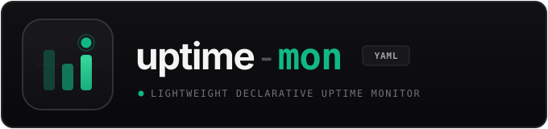
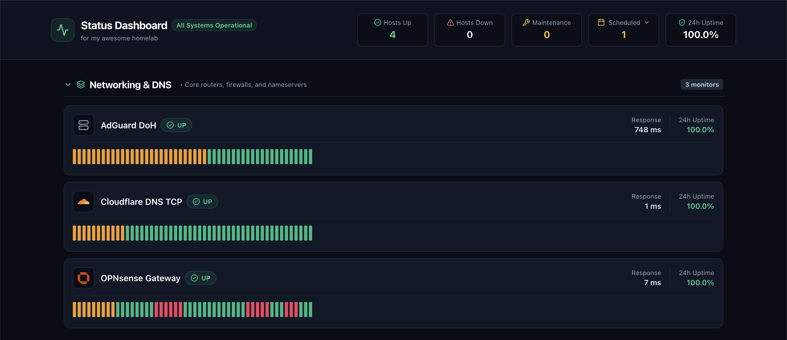

<p align="center">
  
</p>

<p align="center">
  <a href="https://github.com/marekbeckmann/uptime-lightweight/actions/workflows/ci.yml"></a>
  <a href="https://github.com/marekbeckmann/uptime-lightweight/releases"></a>
  <a href="https://go.dev/"></a>
  <a href="https://github.com/marekbeckmann/uptime-lightweight/blob/main/LICENSE"></a>
  <a href="#docker-deployment"></a>
</p>

> [!NOTE]
> This project was developed with AI assistance for frontend UI design and declarative configuration scaffolding.

**uptime-mon** (`uptime-lightweight`) is a lightweight, single-binary, self-hosted uptime and protocol monitoring platform inspired by Uptime Kuma and Gatus. Built with Go and React, it is designed from the ground up for homelabbers and system operators who value GitOps-driven simplicity, resource efficiency, and homelab privacy.

---

### ✨ Features

- 🚀 **Single Static Binary** — Self-contained Go executable embedding the entire React single-page dashboard via `go:embed`. Zero runtime dependencies.
- 📁 **100% Declarative GitOps** — Configured strictly via modular YAML files in `./config/` with zero web-based administration endpoints and no configuration drift.
- ⚡ **Multi-Protocol Probes** — First-class support for **ICMP Ping** (with automatic unprivileged UDP fallback), **TCP** handshake, **DNS** (UDP, TCP, DoT, RFC 8484 DoH), and **HTTPS** (status wildcards `20X`/`30X`, TLS expiry tracking).
- 📊 **Real-time Telemetry Dashboard** — Modern dark-mode interface with live Server-Sent Events (SSE), response latency history, and collapsible zones.
- 🔄 **Live Hot-Reloading** — Modify your YAML configs on the fly; the daemon watches the `./config/` tree and applies changes in-memory without restarting or missing checks.
- 🔔 **Deduplicated Alerting** — Webhooks for **Discord** (rich embeds) and generic JSON endpoints with debounced state transitions and automated recovery alerts.
- 🛠️ **Maintenance Management** — Schedule one-off maintenance windows or recurring Cron-based schedules to mute alerts during planned downtime.
- 🏠 **Homepage Widget Integration** — Built-in, token-authenticated REST API endpoint for native [Homepage](https://gethomepage.dev) Custom API widgets.
- 🗄️ **Embedded SQLite Engine** — Fast, embedded SQLite persistence in WAL mode with automated retention cleanup.

---

<p align="center">
  
</p>

---

## Quickstart

> [!TIP]
> Prefer containerization? You can skip compiling from source and jump straight to the [Docker Deployment](#docker-deployment) section.

### 1. Build Single Executable

```bash
# 1. Build frontend distribution
cd web && npm install && npm run build && cd ..

# 2. Compile standalone binary with embedded assets
go build -o uptime-mon ./cmd/uptime-mon
```

### 2. Validate Configuration

Verify your configuration syntax and endpoint definitions prior to starting the daemon:

```bash
./uptime-mon --config --validate
```

```text
Validating configuration files in ./config...
✓ Global config: OK
✓ 2 zones defined: OK
✓ 4 endpoints defined: OK
✓ 1 one-off maintenance, 1 scheduled: OK
✓ 2 webhooks configured: OK
Configuration valid. 0 errors found.
```

### 3. Generate API Token for Homepage Dashboard Widget

Generate a secure token for external dashboards like [Homepage](https://gethomepage.dev):

```bash
./uptime-mon --api --token --new --name "Homelab Production"
```

> [!CAUTION]
> The API token secret is hashed with bcrypt and cannot be retrieved after creation. Store it in a secure password manager or environment variable.

The command outputs a ready-to-paste `services.yaml` snippet for Homepage:

```yaml
- Uptime Monitor:
    icon: uptime-kuma.png
    href: http://localhost:8080/
    description: System Availability
    widget:
      type: customapi
      url: http://localhost:8080/api/v1/status/summary
      refreshInterval: 10000
      headers:
        X-API-Token-Id: <TOKEN_ID>
        X-API-Token-Secret: <TOKEN_SECRET>
      mappings:
        - field: "Hosts Up"
          label: "Up"
          format: number
        - field: "Hosts Down"
          label: "Down"
          format: number
        - field: "Uptime"
          label: "Uptime"
          format: percent
```

### 4. Start Monitoring Daemon

```bash
./uptime-mon serve --port 8080
```

> [!NOTE]
> `uptime-mon` automatically watches `./config/` for updates. Any modifications made to your YAML files are reloaded in-memory without needing a process restart.

Open your browser to `http://localhost:8080` to access the status dashboard.

---

## CLI Reference

The `uptime-mon` binary provides dedicated subcommands and operational flags:

```bash
# Start monitoring daemon (default if no flags are passed)
uptime-mon serve [--port 8080] [--bind 0.0.0.0] [--config-dir ./config] [--data-dir ./data]

# Configuration validation
uptime-mon --config --validate [--config-dir ./config]

# API Token operations
uptime-mon --api --token --new [--name <label>]
uptime-mon --api --token --list
uptime-mon --api --token --revoke <token_id>
```

---

## Configuration Hierarchy (`./config/`)

All configurations live inside `./config/`. Files can be organized into modular YAML files or consolidated into single definitions.

### 1. Global Defaults: `./config/config.yml`

```yaml
# Global probe intervals & timings
interval: "60s"
timeout: "5s"
retries: 3
timezone: "Europe/Berlin"
history_retention_days: 30
selfhst_icon_cdn: "https://cdn.jsdelivr.net/gh/selfhst/icons/svg/{icon}.svg"

# Zone UI Behavior
disableCollapse: false
initiallyCollapsed: false

# Optional Custom Branding
branding:
  title: "Status Dashboard"
  subtitle: "Homelab Infrastructure"
  footer: "© {current_year} Homelab Ops"
  icon: ""
  favicon: ""
  tab_title: "Status Dashboard"
```

### 2. Zones: `./config/zones/<name>.yml`

Zones categorize monitored endpoints into logical UI groups:

```yaml
- id: "networking"
  display_name: "Networking & DNS"
  description: "Core switches, routers, and firewalls"
  order: 1
  icon: "opnsense"

- id: "webserver"
  display_name: "Web Services & Apps"
  description: "Public portals and internal web services"
  order: 2
  icon: "traefik"
```

### 3. Endpoints: `./config/endpoints/<name>.yml`

Configure endpoints using any of the four supported probe types (`ping`, `tcp`, `dns`, `https`):

```yaml
# ICMP Ping check (with unprivileged UDP fallback)
- id: "gateway-ping"
  display_name: "OPNsense Gateway"
  zone: "networking"
  icon: "opnsense"
  type: "ping"
  target: "1.1.1.1"
  interval: "30s"
  timeout: "3s"
  retries: 3
  show_target: false

# TCP 3-way handshake check
- id: "dns-tcp"
  display_name: "Cloudflare DNS TCP"
  zone: "networking"
  icon: "cloudflare"
  type: "tcp"
  target: "1.1.1.1"
  port: 53
  interval: "30s"

# DNS resolution check (supports udp, tcp, dot, and doh)
- id: "adguard-doh"
  display_name: "AdGuard DoH"
  zone: "networking"
  icon: "adguardhome"
  type: "dns"
  hostname: "cloudflare.com"
  server: "https://dns.adguard-dns.com/dns-query"
  protocol: "doh"
  query_type: "A"

# HTTPS check with status wildcards & TLS certificate expiry monitoring
- id: "public-portal"
  display_name: "Public Portal"
  zone: "webserver"
  icon: "cloudflare"
  type: "https"
  target: "https://cloudflare.com"
  accepted_status_codes: ["20X", "30X"]
  tls_expiry_warn_days: [14, 7, 3]
  show_target: true
```

> [!IMPORTANT]
> When running ICMP Ping probes inside Docker or unprivileged containers, assign the `NET_RAW` Linux capability (`cap_add: [NET_RAW]`) or configure `net.ipv4.ping_group_range` on your host. If raw sockets are unavailable, `uptime-mon` automatically falls back to unprivileged UDP ping.

### 4. Alerting Webhooks: `./config/alerting/<name>.yml`

Receive instant notifications when hosts transition between `UP`, `DOWN`, or entering maintenance:

```yaml
webhooks:
  - id: "discord-ops"
    type: "discord"
    url: "https://discord.com/api/webhooks/xxx/yyy"
    events:
      - "host_down"
      - "host_up"
      - "tls_expiry"
      - "maintenance_created"
      - "maintenance_reminder"

  - id: "generic-siem"
    type: "generic"
    url: "https://alerting.local/webhook"
    events:
      - "host_down"
      - "host_up"
```

### 5. Maintenance Windows: `./config/maintenance/`

- **One-off Maintenance**: `./config/maintenance/<name>.yml`
  ```yaml
  id: "firmware-update"
  title: "Core Switch Firmware Upgrade"
  message: "Switch upgrade and reboot"
  start_date: "2026-11-15"
  start_time: "02:00"
  end_date: "2026-11-15"
  end_time: "04:00"
  remindme: 2
  affected_zones: ["networking"]
  affected_hosts: ["all"]
  ```

- **Recurring Scheduled Maintenance**: `./config/maintenance/scheduled/<name>.yml`
  ```yaml
  id: "sunday-backup"
  title: "Weekly Snapshot & Backup"
  message: "Weekly VM snapshot and database backup"
  schedule: "0 3 * * 0"
  duration: "2h"
  remindme: 1
  affected_zones: ["webserver"]
  affected_hosts: ["public-portal"]
  ```

---

## Docker Deployment

Deploy with Docker Compose for an out-of-the-box self-hosted setup:

```bash
docker compose up -d
```

`docker-compose.yml`:

```yaml
services:
  uptime-mon:
    build:
      context: .
      dockerfile: Dockerfile
    image: uptime-mon:latest
    container_name: uptime-mon
    restart: unless-stopped
    ports:
      - "8080:8080"
    volumes:
      - ./config:/app/config:ro    # Read-only GitOps declarative configuration
      - ./data:/app/data           # Persistent embedded SQLite database
    environment:
      - TZ=Europe/Berlin
    cap_add:
      - NET_RAW                    # Enables privileged ICMP sockets (falls back to UDP if omitted)
```

---

## License

This project is licensed under the [MIT License](LICENSE).
